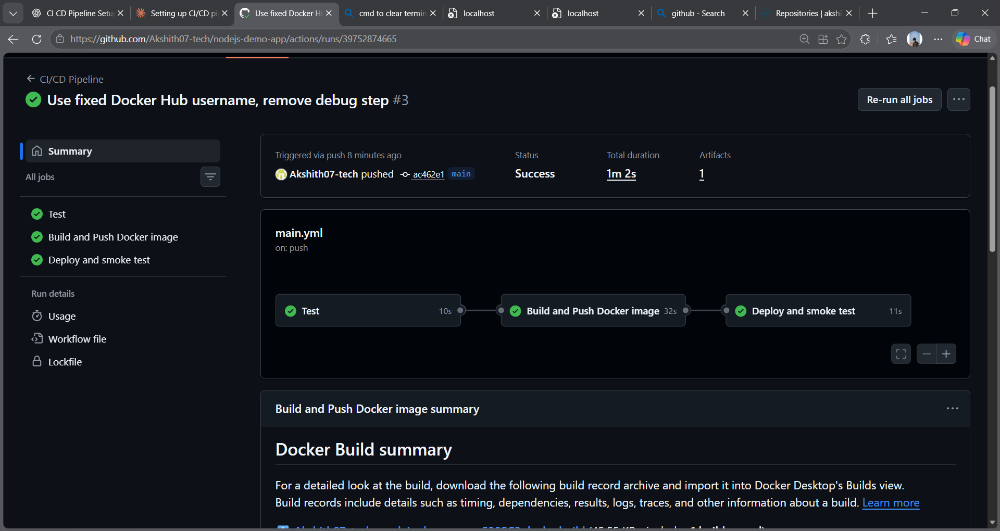
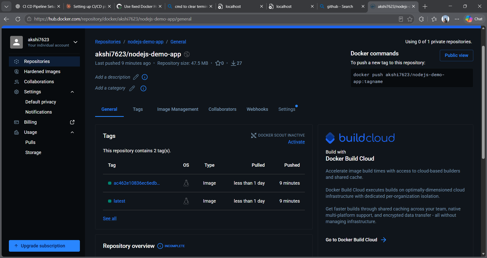

# nodejs-demo-app: CI/CD with GitHub Actions

A sample Node.js (Express) web app with a CI/CD pipeline that automatically tests, builds, pushes to Docker Hub, and smoke-tests the deployed container on every push to `main`.

## Tech stack
Node.js, Express, Docker, Docker Hub, GitHub Actions

## Pipeline (`.github/workflows/main.yml`)

| Job | What it does |
|-----|--------------|
| `test` | Checks out the code, sets up Node 20, runs `npm test` |
| `build-and-push` | Logs in to Docker Hub, builds the Docker image, pushes it as `latest` and as the commit SHA (runs only if tests pass) |
| `deploy` | Pulls and runs the pushed image, then checks `/health` to confirm the deployment works |

**Trigger:** push to `main` (and a manual run via `workflow_dispatch`).

## Secrets used
- `DOCKERHUB_TOKEN`: Docker Hub access token (Read & Write), stored as a GitHub Actions secret

## Run locally
```bash
npm install
npm test
npm start            # http://localhost:3000

docker build -t nodejs-demo-app .
docker run -p 3000:3000 nodejs-demo-app
```

## Endpoints
- `GET /` returns a greeting
- `GET /health` returns `{"status":"ok"}`

## Screenshots



## What I learned
- How a CI/CD pipeline automates test → build → push → deploy
- Jobs, steps, runners, and job dependencies with `needs`
- Securing credentials with GitHub Secrets
- Debugging a failing pipeline: my login failed because of a wrong value in a secret, and I found it by printing the secret's length and character checks (never the value) in a temporary debug step